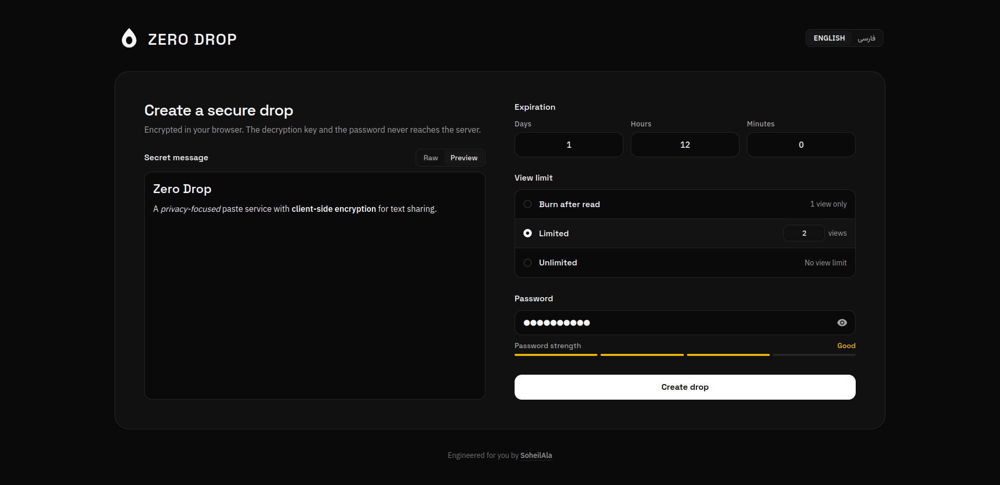

**English** | [فارسی](README.md)

# Zero Drop

A privacy-focused paste service with client-side encryption for text sharing.



## Features

- Client-side encryption with AES-256-GCM (No plaintext or password stored on the server)
- Expiration time and view limits
- Optional password protection using PBKDF2 with strength checker
- Markdown support with XSS sanitization
- Rate limiting and security headers

## How It Works

```text
User
  │
  │ plaintext
  ▼
Browser
  │
  ├── AES-256-GCM encryption
  │
  ├── encryption key ───────────────► URL fragment
  │                                    (#xYz...)
  │
  ├── ciphertext
  ├── IV
  ├── optional KDF salt
  └── hashed consume token
              │
              ▼
      FastAPI + PostgreSQL
```

For regular drops, the encryption key is kept in the URL fragment and never sent to the server.

For password-protected drops, the password is used locally to derive the encryption key. The password itself is never sent to the server.

## Stack

- FastAPI
- PostgreSQL
- Nginx
- Vue 3
- TypeScript
- Tailwind CSS

## Quick Start with Docker

Run the entire stack (Database, Migrations, Backend, and Frontend reverse proxy):

### 1. Environment Setup

```bash
cp .env.example .env
cp backend/.env.example backend/.env
```

Set environment variables.

### 2. Build and start all services

```bash
docker compose up -d --build
```

The application will be accessible at `http://localhost:8080`, with the API at `http://localhost:8000`.

## Local Development

### 1. Backend

```bash
cd backend
uv sync

# Backend (create test database once if not present)
docker exec zero-drop-db createdb -U zero_drop zero_drop_test
uv run pytest

uv run fastapi dev
```

### 2. Frontend

```bash
cd frontend
pnpm install
pnpm test
pnpm dev
```

## License

This project is licensed under the [MIT License](LICENSE).
