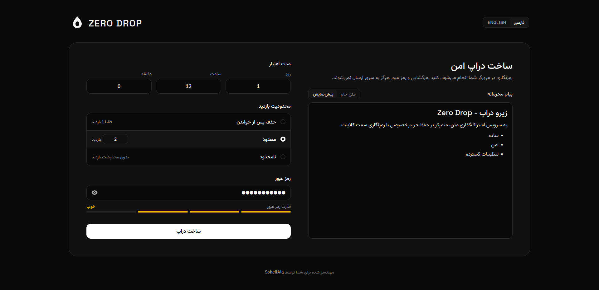

<p align="center">
  
</p>

<h1 align="center">Zero Drop</h1>

<p align="center">
  <a href="README.en.md">English</a> | <strong>فارسی</strong>
</p>

یه سرویس اشتراک‌گذاری متن، متمرکز بر حفظ حریم خصوصی با رمزنگاری سمت کلاینت.



## ✨ ویژگی‌ها

- رمزنگاری سمت کلاینت با AES-256-GCM (پیام و رمز عبور هرگز در سرور ذخیره نمی‌شن)
- تعیین زمان انقضا و محدودیت تعداد بازدید
- محافظت با رمز عبور (اختیاری) با استفاده از PBKDF2 و بررسی قدرت رمز
- پشتیبانی از Markdown همراه با پیش‌نمایش زنده و ایمن‌سازی در برابر حملات XSS
- دارای Rate limiting و هدرهای امنیتی

## ❓ نحوه کار

```text
User
  │
  │ plaintext
  ▼
Browser
  │
  ├── AES-256-GCM encryption
  │
  ├── encryption key ───────────────► URL fragment
  │                                    (#xYz...)
  │
  ├── ciphertext
  ├── IV
  ├── optional KDF salt
  └── hashed consume token
              │
              ▼
      FastAPI + PostgreSQL
```

- در دراپ‌های معمولی، کلید رمزگشایی داخل بخش فرگمنت URL نگهداری می‌شه و هیچ وقت به سرور نمی‌رسه.
- در دراپ‌های محافظت‌شده با رمز، رمز عبور مستقیما در مرورگر برای تولید کلید رمزگشایی استفاده می‌شه و خود رمز هیچ وقت به سرور ارسال نمی‌شه.

## 🛠️ تکنولوژی‌ها

- FastAPI
- PostgreSQL
- Nginx
- Vue 3
- TypeScript
- Tailwind CSS

## 🚀 اجرای سریع با Docker

### ۱. تنظیم متغیرهای محیطی

```bash
cp .env.example .env
cp backend/.env.example backend/.env
```

### ۲. بیلد و اجرای سرویس‌ها

```bash
docker compose up -d --build
```

برنامه در آدرس `http://localhost:8080` و API در `http://localhost:8000` در دسترس خواهد بود.

## 💻 توسعه لوکال

### ۱. بک‌اند

```bash
cd backend
uv sync

# ساخت پایگاه داده تست (یه بار در صورت نیاز)
docker exec zero-drop-db createdb -U zero_drop zero_drop_test
uv run pytest

uv run fastapi dev
```

### ۲. فرانت‌اند

```bash
cd frontend
pnpm install
pnpm test
pnpm dev
```

## 📄 لایسنس

این پروژه تحت لایسنس [MIT](LICENSE) منتشر شده.
